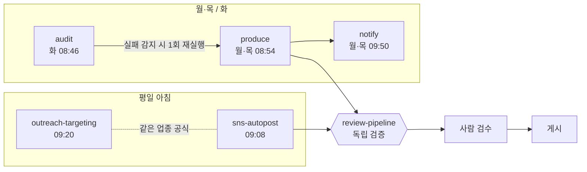

# ai-workflow-portfolio

재경·무역 실무자가 설계해 실제로 운영 중인 AI 업무 파이프라인 모음입니다.
사람 없이 돌아가도 틀리지 않고, 중복되지 않고, 실패하면 스스로 복구되는 것을 목표로 만들었습니다.

- 실행 환경: Claude 예약 작업(scheduled tasks, cron) + 하위 에이전트 + 커스텀 스킬
- 연결 서비스: Google Drive, Gmail, Notion, Metricool(SNS 예약 게시), GitHub API
- 운영 기간: 2026.10~ (현재 운영 중)

> 이 저장소의 파일은 실제 운영 설정에서 내부 ID·계정·메일 주소·사업 상호만 `<PLACEHOLDER>`로 바꾼 것입니다. 구조와 규칙은 원본 그대로입니다.

## 구조

## 프로젝트

| 경로 | 무엇 | 실행 |
|---|---|---|
| [`skills/review-pipeline`](skills/review-pipeline/SKILL.md) | 결과물을 만든 AI가 아닌 별도 AI가 검증하는 4단계 스킬 | 다른 파이프라인이 호출 |
| [`pipelines/sns-autopost.md`](pipelines/sns-autopost.md) | 글 작성 → 독립 검증 → 10시 자동 게시 예약 → 30분 전 사람 검수 | 평일 09:08 |
| [`pipelines/content-factory/`](pipelines/content-factory/) | 제작 → 게시 알림 → 주간 점검·자동 복구 3개 작업 | 월·목 / 화 |
| [`pipelines/outreach-targeting.md`](pipelines/outreach-targeting.md) | sns-autopost와 같은 업종 공식으로 그날 영업 타깃을 정함 | 평일 09:20 |

## 설계 원칙

**독립 검증.** 검증자는 작성 과정을 모르는 새 하위 에이전트입니다. 결론과 근거 URL만 받고, 작성자의 추론은 받지 않습니다. 자기 점검은 검증으로 치지 않습니다.

**중복 실행 방지.** 게시·예약·폴더 생성 전에 오늘 것이 이미 있는지 조회합니다. 재시도 전에도 다시 조회합니다.

**날짜는 코드로.** 날짜·요일·순번 계산은 전부 코드로 합니다. 모델이 요일을 틀리는 문제를 원천 차단합니다.

**마감 시각과 대체 경로.** 단계마다 마감 시각이 있고, 넘기면 결과물에 상태(`독립 검증 없음` 등)를 적고 다음으로 넘어갑니다.

**자동 복구.** 주간 점검 작업이 제작 작업의 실행 기록과 결과 파일을 확인하고, 빠졌으면 1회 재실행합니다.

**상태 저장소 없음.** 회차 번호와 성공 여부를 드라이브 폴더 이름과 파일 존재로 판단합니다. 여러 작업이 같은 기준을 봅니다.

**사람 검수.** 자동 게시도 게시 30분 전에 사람에게 검수 알림이 갑니다.

## 작성자

정세나 · 재경·무역 실무(2020~) · 한국어·중국어
